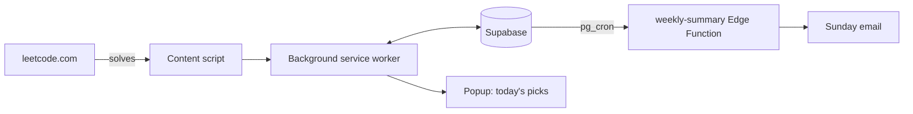

<!-- prettier-ignore -->
<div align="center">


# LeetCode Revision Buddy


[](https://wxt.dev)
[](https://www.typescriptlang.org)
[](https://react.dev)
[](https://supabase.com)


[Overview](#overview) • [Features](#features) • [How picking works](#how-picking-works) • [Getting started](#getting-started) • [Development](#development)

</div>

A browser extension that picks three LeetCode problems a day for you to revise, from topics you've already solved, so the patterns you learned are still there when the interview comes.

## Overview

Grinding through Blind 75 or NeetCode 150 once is the easy part. Remembering how sliding window works three months later is harder. Revision Buddy watches what you solve on leetcode.com, keeps a spaced-repetition schedule for each topic, and brings a topic back just before you'd forget it.

Each pick comes with a short reason, for example `Graphs · 4 days overdue · last solved 23 days ago`.



## Features

- **Three picks a day.** New picks arrive at a time you choose and stay the same all day. "Pick again" swaps any you haven't finished.
- **Spaced repetition per topic.** Each topic (Trees, Two Pointers, 1-D DP and so on) has its own SM-2 schedule. Rate a finished pick Again, Hard, Good or Easy, and the topic's next due date moves to match.
- **Solve detection.** When LeetCode shows "Accepted", the extension syncs your recent submissions. Solves made outside your picks count as reviews too.
- **History import.** Pull in everything you've already solved, so the schedule starts from where you really are.
- **Interview-weighted topics.** Topics that come up more in interviews, like arrays, trees and graphs, get picked more often. You can override any topic's weight.
- **Difficulty that adjusts.** If a topic went well last time, the next problem is a step harder. If it went badly, the next one is a step easier.
- **Curated lists.** Problems come from Blind 75, NeetCode 150 and Striver's A2Z sheet, with or without premium problems.
- **Reminders.** A toolbar badge shows how many picks are left. You can also turn on a desktop notification for new picks and a weekly summary email on Sunday evening.
- **On-page banner.** When you open one of today's picks, a small banner appears on the problem page so you can rate it without leaving.

## How picking works

Each topic that's due gets a score:

```
score = weight × aging × practised × struggling
```

| Term | Meaning |
|---|---|
| `weight` | How often the topic comes up in interviews (0.5 to 2.0), or your override |
| `aging` | `1 + daysOverdue / interval`, so a topic gets more urgent the longer it's left overdue |
| `practised` | `0.7 ^ solvesThisWeek` (never below 0.3), so topics you've already done this week score lower |
| `struggling` | 1.5 if your last rating was Again or Hard, otherwise 1 |

One slot always goes to the most overdue topic, so low-weight topics can't be crowded out for good. The other two slots go to the highest scores. If fewer than three topics are due, the topics with the lowest ease fill the gap.

Within a topic, the extension prefers a problem you haven't solved yet near the target difficulty. If there isn't one, it falls back to the problem you solved longest ago. It skips anything recommended in the last seven days.

The scheduler and the picker are pure functions in [`srs.ts`](extension/lib/srs.ts) and [`candidates.ts`](extension/lib/candidates.ts). Their tests include a 90-day starvation simulation that checks every topic still gets reviewed.

## Getting started

### Prerequisites

- [Node.js](https://nodejs.org) 22.18 or later (the scripts run TypeScript directly) and [pnpm](https://pnpm.io)
- A [Supabase](https://supabase.com) project
- `psql` on your PATH, for running migrations
- Chrome, or Firefox 140 or later

### 1. Install and configure

```sh
pnpm install
cp extension/.env.example extension/.env
cp scripts/.env.example scripts/.env
```

Fill in both files. `extension/.env` holds only public values (the project URL and anon key), because row-level security protects the data. `scripts/.env` holds the service-role key and database URL. Run `pnpm check-env` from `scripts/` to check it.

> [!CAUTION]
> The service-role key bypasses row-level security. It belongs only in `scripts/.env` and in Edge Function secrets, never in `extension/`.

### 2. Set up the database

Apply the migrations in order (this needs `SUPABASE_DB_URL`), then upload the problem catalog:

```sh
cd scripts
pnpm migrate ../supabase/migrations/0001_catalog.sql
pnpm migrate ../supabase/migrations/0002_user_settings.sql
# ...and so on, through the last file in supabase/migrations
pnpm upload
```

`pnpm upload` loads the catalog already committed in `scripts/data/`. To rebuild it from the source lists first, run `pnpm seed` instead, which runs `fetch-lists`, then `enrich`, then `upload`. The catalog stores only problem metadata (slug, title, difficulty, tags, URL), never problem statements.

### 3. Run the extension

```sh
pnpm dev
```

This opens Chrome with the extension loaded and hot reload on. In that window, log in to leetcode.com, open the extension's options page, sign in, and import your history.

For a regular build, run `pnpm build`, then load `extension/.output/chrome-mv3` as an unpacked extension from `chrome://extensions`, with Developer mode turned on.

> [!TIP]
> By default, `pnpm dev` starts a new temporary profile on every run, so you have to log in again each time. To keep the profile, create `extension/web-ext.config.ts` (it's gitignored):
>
> ```ts
> import { defineWebExtConfig } from 'wxt';
>
> export default defineWebExtConfig({
>   chromiumArgs: ['--user-data-dir=./.wxt/chrome-data'],
> });
> ```

> [!TIP]
> Sign-in uses a one-time code sent by email, which works out of the box. To add Google sign-in, enable the Google provider in Supabase, add the redirect URL shown on the options page, and set `WXT_GOOGLE_SIGN_IN=true`.

### 4. Weekly email (optional)

An Edge Function sends the summary, and pg_cron calls it every hour. Each user who opted in gets the email once a week, on Sunday at 18:00 in their own time zone. Add `SMTP_USER` and `SMTP_PASS` to `scripts/.env` (for Gmail, use an app password), then:

```sh
cd scripts
npx supabase login          # once
pnpm deploy-weekly          # add --send to email yourself a test now
```

## Development

Run these from the repo root:

| Command | Description |
|---|---|
| `pnpm dev` | Launch Chrome with the extension and hot reload (`dev:firefox` for Firefox) |
| `pnpm build` | Production build into `extension/.output/` |
| `pnpm compile` | Type-check |
| `pnpm test` | Run the Vitest suite |
| `pnpm zip` | Package for the Chrome Web Store |

The repo is a pnpm workspace with two packages, `extension` and `scripts`:

```
extension/
  entrypoints/
    background.ts          service worker: alarms, sync, messaging, badge
    leetcode.content.ts    content script on leetcode.com: solve detection, history import, banner
    popup/                 today's picks
    options/               sign-in, settings, topics, sync and account data
  lib/                     scheduling (srs.ts), picking (candidates.ts), LeetCode and Supabase clients
  components/              shared UI components
  assets/, public/         theme, icons, privacy policy
scripts/
  src/                     list scrapers, enrich, upload, migrate, check-env, deploy-weekly
  data/                    generated catalog JSON
supabase/
  migrations/              SQL schema, applied in order
  functions/weekly-summary/  weekly summary email Edge Function
```

To debug, open these:

- **Service worker:** `chrome://extensions`, then this extension, then "Inspect views: service worker"
- **Popup:** right-click it and choose Inspect
- **Content script:** the DevTools console on a leetcode.com tab
- **Edge Function:** Supabase dashboard, then Edge Functions, then weekly-summary, then Logs

> [!NOTE]
> LeetCode's API is undocumented and can change without notice. Every call to it goes through [`leetcode.ts`](extension/lib/leetcode.ts), so a fix should only need to touch that file. Only leetcode.com is supported, not leetcode.cn.

## Privacy

The backend stores your account email, your LeetCode username, your settings, and which problems from the supported lists you've solved and when. Your code, your submissions and problem statements are never stored. You can delete your account and all its data from the options page. See the full [privacy policy](extension/public/privacy.html).
